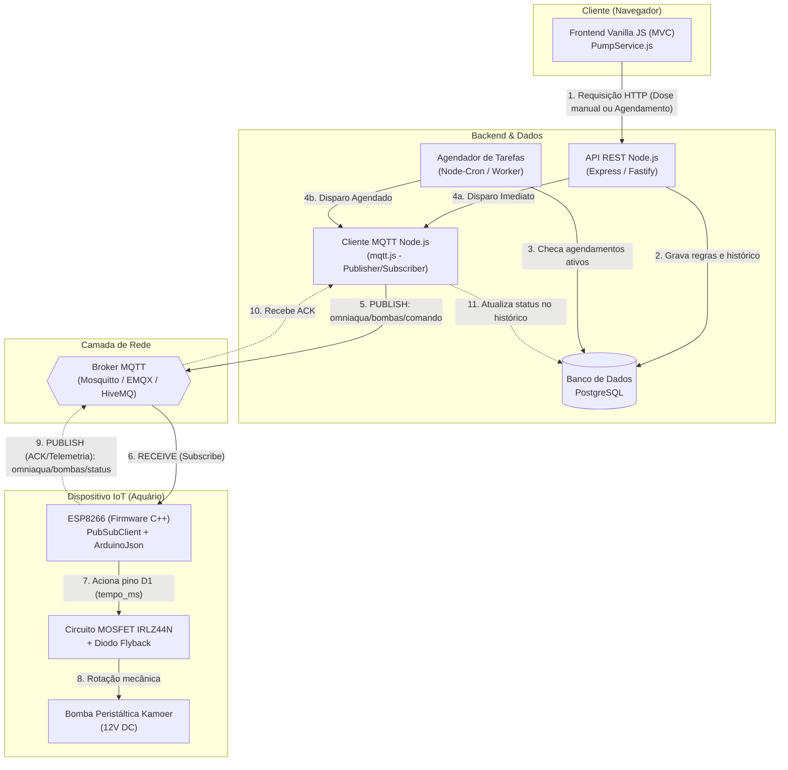

# 🌊 OmniAqua — Documento de Transição Técnica (Handoff)
**Projeto:** OmniAqua — Sistema Automatizado de Dosagem para Aquários  
**Papel:** Tech Lead de IoT e Arquitetura de Software  
**Destinatários:** Time de Desenvolvimento (Backend Node.js, Banco de Dados PostgreSQL e Firmware ESP8266)  
**Versão:** 1.0.0  
**Data:** Novembro de 2026  

---

## 1. Visão Geral e Boas-Vindas

Chegamos a um marco crucial no **OmniAqua**. Validamos com sucesso a prova de conceito (PoC) do hardware físico e construímos a fundação da interface do usuário (Dashboard web responsivo).

Agora estamos mudando oficialmente de fase: vamos transformar esse protótipo de bancada em uma solução IoT robusta, desacoplada, segura e escalável.

Este documento é o guia oficial de arquitetura, contrato de dados e plano de execução (To-Do List) dividido por frentes de trabalho. Leiam com atenção antes de codificar.

---

## 2. Status Atual: O Que Já Está Pronto

### 2.1 Hardware Validado (Bancada)
- **Controlador:** ESP8266 (NodeMCU / ESP-12E / Wemos D1 Mini).
- **Atuador:** Bomba peristáltica Kamoer (alimentação nominal de 12V DC).
- **Driver de Potência:** Transistor MOSFET canal N **IRLZ44N** (nível lógico compatível com 3.3V do ESP8266).
- **Circuito de Alimentação:** 
  - Fonte primária de 12V DC para alimentação da bomba.
  - Módulo regulador de tensão step-down (**Buck Converter**) reduzindo os 12V para 5V na entrada `VIN` da placa ESP8266.
  - **GND unificado** entre a fonte 12V, saída do Buck converter, placa ESP8266 e o Source do MOSFET.
- **Pino de Acionamento:** Pino digital **`D1`** (correspondente ao **GPIO 5** no ESP8266) aciona o Gate do MOSFET.
- **Proteções Elétricas Implementadas:**
  - Resistor de pull-down (10kΩ) entre o Gate e o GND para manter a bomba desligada durante o boot/reset do microcontrolador.
  - Resistor limitador de corrente (220Ω a 330Ω) entre o pino `D1` e o Gate do MOSFET.
  - Diodo flyback (1N4007) polarizado reversamente em paralelo com a bomba peristáltica (carga indutiva) para absorver transientes de tensão (kickback EMF) no desligamento.

### 2.2 Frontend (Dashboard Web)
- **Localização:** Raiz do repositório (`index.html`, `css/styles.css`, `js/`).
- **Arquitetura:** Vanilla JavaScript Modular com padrão **MVC** (Model-View-Controller) e sem necessidade de bundlers pesados para desenvolvimento rápido.
  - [`js/controllers/AppController.js`](file:///f:/pdfaqua/omniaquapp/js/controllers/AppController.js): Orquestra os eventos da interface, validações e bloqueio de concorrência (`aria-busy`).
  - [`js/services/PumpService.js`](file:///f:/pdfaqua/omniaquapp/js/services/PumpService.js): Camada de serviço de dados. Atualmente mockada com `Promise.resolve()` e `console.log()`. **Esta é a classe que o time de Backend conectará com os endpoints da API REST.**
  - [`js/views/PumpView.js`](file:///f:/pdfaqua/omniaquapp/js/views/PumpView.js): Renderização dinâmica dos cards das bombas peristálticas.
  - [`js/views/FeedbackView.js`](file:///f:/pdfaqua/omniaquapp/js/views/FeedbackView.js): Notificações acessíveis (Toast / ARIA alerts).
  - [`js/views/OceanView.js`](file:///f:/pdfaqua/omniaquapp/js/views/OceanView.js): Visualização interativa e estética marinha em Canvas.
- **Design System:** Tailwind CSS via CDN com folha de estilos personalizada (`css/styles.css`).

---

## 3. Arquitetura Alvo: Fluxo Pub/Sub com MQTT

Aquários contêm animais sensíveis (corais, peixes e plantas). Uma falha no dosador pode causar subdosagem ou, pior, overdose fatal de elementos como Cálcio, Reserva Alcalina (KH) ou Magnésio.

Por isso, **desacoplamos a inteligência de negócios do hardware físico**:
1. O microcontrolador não decide horários nem faz cálculos matemáticos complexos de dosagem. Ele opera como um **atuador resiliente de tempo**.
2. O Backend centraliza relógios (NTP), persistência, auditoria e agendamentos.
3. A comunicação assíncrona entre o Backend e a ESP8266 ocorre pelo protocolo **MQTT**, ideal para IoT por ser leve, baseado em push e tolerante a oscilações de rede.

### 3.1 Diagrama de Arquitetura



### 3.2 O Fluxo Explicado
1. **Frontend (Browser):** O aquarista clica em "Dosar Agora" ou define um agendamento ("08:00 - 5 ml"). O `PumpService` dispara um `POST` para a API Node.js.
2. **Backend API:** Valida os dados e salva os agendamentos no PostgreSQL.
3. **Conversão de Volume para Tempo (Crucial):** O Backend converte o volume ($ml$) em tempo de motor ligado ($ms$) com base na vazão calibrada da bomba:
   $$\text{tempo\_ms} = \left(\frac{\text{volume\_ml}}{\text{vazao\_ml\_por\_minuto}}\right) \times 60.000$$
4. **Disparo MQTT:** No horário agendado (ou via botão imediato), o backend publica um JSON no tópico `omniaqua/bombas/comando` com QoS 1.
5. **ESP8266:** Recebe o pacote, faz o parse do JSON e liga o pino `D1` exatamente pelo tempo estipulado (`tempo_ms`), desligando em seguida de forma não-bloqueante.
6. **Confirmação (ACK):** A ESP8266 publica uma mensagem no tópico `omniaqua/bombas/status` avisando que a dosagem ocorreu com sucesso, permitindo ao backend auditar o histórico no banco de dados.

---

## 4. Contrato de Mensageria (MQTT + JSON)

Para garantir interoperabilidade entre o time de Backend e o time de Firmware, este contrato deve ser seguido estritamente.

### 4.1 Tópicos MQTT Padronizados
| Tópico | Origem | Destino | QoS | Descrição |
| :--- | :--- | :--- | :---: | :--- |
| `omniaqua/bombas/comando` | Backend | ESP8266 | 1 | Instrução de acionamento de bomba |
| `omniaqua/bombas/status` | ESP8266 | Backend | 1 | Confirmação de execução (ACK) e erros |
| `omniaqua/dispositivo/status` | ESP8266 | Backend | 1 | Status de conectividade (LWT: online/offline) |

---

### 4.2 Payload de Comando (`omniaqua/bombas/comando`)
Enviado pelo Backend para ordenar uma dosagem.

```json
{
  "comando_id": "c1f9b37a-4318-4e56-9a25-a765d79199d0",
  "id_bomba": 1,
  "tempo_ms": 5000,
  "timestamp": 1715374800
}
```

#### Especificação dos Campos:
- `comando_id` (`string / UUID`): Identificador único do comando para rastreamento ponta a ponta e deduplicação no banco.
- `id_bomba` (`integer`, `1` a `4`): Número da bomba a ser acionada. No hardware atual, a bomba 1 mapeia para o pino `D1`.
- `tempo_ms` (`integer`, `100` a `30000`): Duração exata do acionamento em milissegundos.
  > [!IMPORTANT]
  > **Fail-Safe de Hardware:** O firmware da ESP8266 deve rejeitar qualquer comando com `tempo_ms > 30000` (30 segundos). Isso impede que um bug no backend esvazie um frasco de aditivo inteiro dentro do aquário.
- `timestamp` (`integer`, epoch Unix): Momento do disparo do comando.

---

### 4.3 Payload de Confirmação e Telemetria (`omniaqua/bombas/status`)
Enviado pela ESP8266 assim que o acionamento é finalizado.

```json
{
  "comando_id": "c1f9b37a-4318-4e56-9a25-a765d79199d0",
  "id_bomba": 1,
  "status": "CONCLUIDO",
  "tempo_executado_ms": 5000,
  "rssi": -62,
  "uptime_s": 84210
}
```

#### Códigos de `status` Possíveis:
- `"CONCLUIDO"`: Dosagem executada com sucesso.
- `"ERRO_PARAMETRO_INVALIDO"`: ID de bomba desconhecido ou tempo fora da faixa segura.
- `"ERRO_DISPOSITIVO_OCUPADO"`: A bomba já estava executando outra dosagem.

---

### 4.4 Status de Conexão com LWT (`omniaqua/dispositivo/status`)
Configurar o **Last Will and Testament (LWT)** no cliente MQTT do ESP8266:
- Quando desconectar abruptamente (queda de energia/wifi): o Broker publica automaticamente `"offline"`.
- Quando conectar com sucesso: a ESP publica `"online"` com `retain: true`.

---

## 5. To-Do List: Backend & Banco de Dados (Node.js + PostgreSQL)

Responsável por orquestrar regras, persistir agendamentos, calcular tempos de dosagem e manter o Broker informado.

### 5.1 Modelagem e Banco de Dados (PostgreSQL)
- [ ] Criar banco de dados `omniaqua` e configurar conexão via pool (`pg` ou Prisma / Drizzle / TypeORM).
- [ ] Executar migration para a tabela de configuração das bombas:
  ```sql
  CREATE TABLE bombas (
      id SERIAL PRIMARY KEY,
      nome VARCHAR(50) NOT NULL, -- Ex: "Cálcio", "Magnésio", "Reserva Alcalina"
      pino_gpio INT NOT NULL DEFAULT 5, -- GPIO5 = D1 na ESP8266
      vazao_ml_min NUMERIC(6,2) NOT NULL DEFAULT 60.00, -- Calibração: ml por minuto da bomba
      capacidade_recipiente_ml NUMERIC(7,2) DEFAULT 1000.00,
      volume_restante_ml NUMERIC(7,2) DEFAULT 1000.00,
      ativo BOOLEAN DEFAULT true,
      criado_em TIMESTAMP WITH TIME ZONE DEFAULT NOW()
  );
  ```
- [ ] Executar migration para a tabela de agendamentos diários:
  ```sql
  CREATE TABLE agendamentos (
      id SERIAL PRIMARY KEY,
      bomba_id INT REFERENCES bombas(id) ON DELETE CASCADE,
      volume_ml NUMERIC(5,2) NOT NULL,
      horario TIME NOT NULL, -- Ex: '08:00:00'
      dias_semana VARCHAR(20) DEFAULT 'ALL', -- 'ALL' ou lista '1,2,3,4,5,6,7'
      ativo BOOLEAN DEFAULT true,
      criado_em TIMESTAMP WITH TIME ZONE DEFAULT NOW()
  );
  ```
- [ ] Executar migration para histórico de dosagens executadas (Auditoria):
  ```sql
  CREATE TABLE historico_dosagens (
      id SERIAL PRIMARY KEY,
      comando_id UUID NOT NULL UNIQUE,
      bomba_id INT REFERENCES bombas(id),
      volume_ml NUMERIC(5,2) NOT NULL,
      tempo_ms INT NOT NULL,
      tipo_disparo VARCHAR(20) NOT NULL, -- 'MANUAL' ou 'AGENDADO'
      status VARCHAR(30) NOT NULL DEFAULT 'PENDENTE', -- 'PENDENTE', 'ENVIADO', 'CONCLUIDO', 'FALHA'
      disparado_em TIMESTAMP WITH TIME ZONE DEFAULT NOW(),
      confirmado_em TIMESTAMP WITH TIME ZONE
  );
  ```

### 5.2 API REST (Express ou Fastify)
- [ ] Inicializar o projeto (`npm init -y`) com suporte a ES Modules (`"type": "module"`).
- [ ] Configurar variáveis de ambiente com `dotenv`:
  - `PORT`, `DATABASE_URL`, `MQTT_BROKER_URL`, `MQTT_USERNAME`, `MQTT_PASSWORD`, `MQTT_CLIENT_ID`.
- [ ] Implementar rotas da API:
  - `GET /api/bombas`: Retorna a lista de bombas e níveis de reservatório.
  - `POST /api/bombas/:id/dosar`: Disparo manual imediato.
  - `GET /api/agendamentos`: Lista todos os agendamentos cadastrados.
  - `POST /api/agendamentos`: Cadastra novo horário e volume para uma bomba.
  - `DELETE /api/agendamentos/:id`: Remove um agendamento.
  - `GET /api/historico`: Retorna as últimas dosagens efetuadas para monitoramento.

### 5.3 Módulo de Calibração e Disparo MQTT
- [ ] Instalar o pacote oficial: `npm install mqtt`.
- [ ] Criar serviço `mqttClient.js` configurado com reconexão automática:
  - Conectar ao broker com QoS 1.
  - Publicar mensagens no formato JSON especificado na Seção 4.2.
- [ ] Criar função utilitária de conversão de volume:
  ```javascript
  export function calcularTempoAcionamentoMs(volumeMl, vazaoMlMin) {
    if (volumeMl <= 0 || vazaoMlMin <= 0) throw new Error("Parâmetros de dosagem inválidos.");
    const tempoMs = Math.round((volumeMl / vazaoMlMin) * 60000);
    // Limite máximo de segurança no Backend: 30 segundos
    return Math.min(tempoMs, 30000);
  }
  ```
- [ ] Implementar listener no backend assinando o tópico `omniaqua/bombas/status`:
  - Ao receber payload com status `"CONCLUIDO"`, atualizar a tabela `historico_dosagens` para status correspondente e abater o `volume_ml` da coluna `volume_restante_ml` na tabela `bombas`.

### 5.4 Agendador de Tarefas (Cron / Scheduler)
- [ ] Instalar `node-cron` ou configurar worker assíncrono.
- [ ] Criar job executado a cada minuto (`* * * * *`):
  - Consultar agendamentos ativos compatíveis com a hora e minuto atuais.
  - Para cada agendamento, gerar um `comando_id` (UUID), registrar na tabela `historico_dosagens` como `PENDENTE` e publicar no tópico MQTT `omniaqua/bombas/comando`.

### 5.5 Conexão com o Frontend Existente
- [ ] Configurar CORS no backend para permitir chamadas do frontend.
- [ ] Atualizar o arquivo [`js/services/PumpService.js`](file:///f:/pdfaqua/omniaquapp/js/services/PumpService.js):
  - Substituir os retornos estáticos de `getPumps()`, `doseNow()` e `scheduleDose()` por chamadas reais via `fetch()` para a API Node.js.

---

## 6. To-Do List: Firmware de Embarcados (ESP8266 em C++)

Responsável por manter conexão estável com o Wi-Fi e Broker MQTT, interpretar comandos em JSON e controlar o hardware físico sem travar o processamento da placa.

### 6.1 Setup do Ambiente e Bibliotecas
- [ ] Configurar projeto no **PlatformIO** (recomendado via VS Code) ou Arduino IDE para a placa `esp12e` / `nodemcuv2` / `d1_mini`.
- [ ] Instalar dependências no `platformio.ini` (ou Library Manager):
  - `knolleary/PubSubClient` (v2.8+)
  - `bblanchon/ArduinoJson` (v6.21+ ou v7)
  - `ESP8266WiFi` (Core ESP8266)
- [ ] Mapear o pino físico:
  ```cpp
  #define PINO_BOMBA_1 D1 // GPIO5
  #define TEMPO_MAXIMO_SEGURANCA_MS 30000 // Trava máxima de 30 segundos
  ```

### 6.2 Estrutura do Firmware e Não-Bloqueio (`millis()`)
> [!CAUTION]
> **Proibido usar `delay()` longo:** Chamar `delay(5000)` trava a execução do ESP8266, impede a resposta aos pacotes de ping do Broker MQTT (fazendo a placa cair por timeout) e pode disparar o Watchdog Timer (WDT reset). Use controle de tempo assíncrono com `millis()`.

- [ ] Definir variáveis globais de estado da bomba:
  ```cpp
  bool bombaLigada = false;
  unsigned long tempoFimDosagem = 0;
  String comandoIdAtual = "";
  unsigned long duracaoExecutadaMs = 0;
  ```
- [ ] No `setup()`:
  - Configurar `pinMode(PINO_BOMBA_1, OUTPUT);`
  - Garantir estado inicial seguro: `digitalWrite(PINO_BOMBA_1, LOW);`
  - Inicializar Serial (`115200` baud) para depuração.

### 6.3 Gestão de Conexão Wi-Fi e MQTT Resiliente
- [ ] Implementar rotina de conexão Wi-Fi com verificação de reconexão automática:
  ```cpp
  void conectaWiFi() {
    if (WiFi.status() == WL_CONNECTED) return;
    WiFi.mode(WIFI_STA);
    WiFi.begin("SSID_WIFI", "SENHA_WIFI");
    // Aguardar conexão sem loop infinito bloqueante
  }
  ```
- [ ] Configurar cliente MQTT (`PubSubClient`):
  - Ajustar tamanho do buffer de payload: `client.setBufferSize(512);` (necessário para JSON).
  - Configurar Last Will and Testament (LWT) no tópico `omniaqua/dispositivo/status` com mensagem `"offline"`.
  - Definir a função de callback: `client.setCallback(mqttCallback);`.
- [ ] Na reconexão com o Broker:
  - Conectar passando credenciais e LWT.
  - Publicar `"online"` (com flag `retain: true`) no tópico `omniaqua/dispositivo/status`.
  - Assinar o tópico de comando: `client.subscribe("omniaqua/bombas/comando", 1);`.

### 6.4 Callback de Mensagem e Parsing de JSON
- [ ] No callback de mensagem MQTT:
  - Converter payload recebido em buffer legível.
  - Realizar o parse seguro com `ArduinoJson`:
    ```cpp
    StaticJsonDocument<256> doc;
    DeserializationError error = deserializeJson(doc, payload, length);
    if (error) {
      Serial.println(F("[ERRO] Falha ao decodificar JSON MQTT"));
      return;
    }

    const char* comandoId = doc["comando_id"];
    int idBomba = doc["id_bomba"];
    unsigned long tempoMs = doc["tempo_ms"];
    ```
  - Validar se `idBomba == 1` e se a bomba não está ocupada.
  - Aplicar trava de segurança:
    ```cpp
    if (tempoMs <= 0 || tempoMs > TEMPO_MAXIMO_SEGURANCA_MS) {
      publicaStatus(comandoId, idBomba, "ERRO_PARAMETRO_INVALIDO", 0);
      return;
    }
    ```
  - Iniciar a dosagem:
    ```cpp
    digitalWrite(PINO_BOMBA_1, HIGH);
    bombaLigada = true;
    tempoFimDosagem = millis() + tempoMs;
    comandoIdAtual = comandoId;
    duracaoExecutadaMs = tempoMs;
    ```

### 6.5 Gerenciamento do Ciclo no `loop()`
- [ ] Manter o `client.loop()` executando a cada iteração:
  ```cpp
  void loop() {
    if (WiFi.status() != WL_CONNECTED) conectaWiFi();
    if (!client.connected()) reconectaMQTT();
    client.loop();

    // Verificação não-bloqueante do desligamento da bomba
    if (bombaLigada && (millis() >= tempoFimDosagem)) {
      digitalWrite(PINO_BOMBA_1, LOW);
      bombaLigada = false;
      
      // Envia confirmação (ACK) para o Broker
      publicaStatus(comandoIdAtual.c_str(), 1, "CONCLUIDO", duracaoExecutadaMs);
    }
  }
  ```

### 6.6 Publicação de Confirmação (ACK)
- [ ] Criar função utilitária para envio de status:
  ```cpp
  void publicaStatus(const char* comandoId, int idBomba, const char* status, unsigned long tempoMs) {
    StaticJsonDocument<256> res;
    res["comando_id"] = comandoId;
    res["id_bomba"] = idBomba;
    res["status"] = status;
    res["tempo_executado_ms"] = tempoMs;
    res["rssi"] = WiFi.RSSI();
    res["uptime_s"] = millis() / 1000;

    char buffer[256];
    serializeJson(res, buffer);
    client.publish("omniaqua/bombas/status", buffer, true);
  }
  ```

---

## 7. Critérios de Aceite para Testes de Integração Ponta a Ponta

Para considerarmos a fase concluída e homologada, o seguinte teste de validação deve passar com sucesso:

1. Subir Broker MQTT local (ex: via Docker com `eclipse-mosquitto`).
2. Ligar a placa ESP8266 na rede Wi-Fi e verificar mensagem `"online"` no tópico `omniaqua/dispositivo/status`.
3. Iniciar API Node.js e banco de dados PostgreSQL.
4. No Dashboard Web (`index.html`), preencher a Bomba 1 com `2 ml` e clicar em **"Dosar Agora"**:
   - O botão deve exibir estado de processamento (`aria-busy="true"`).
   - O Backend deve calcular o tempo em milissegundos correspondente aos 2 ml e publicar no Broker MQTT.
   - A ESP8266 deve acionar a bomba Kamoer via MOSFET pelo tempo exato.
   - O motor deve parar automaticamente sem interferência de comandos externos.
   - A ESP8266 deve publicar o status `"CONCLUIDO"`.
   - O Backend deve registrar a confirmação na tabela `historico_dosagens`.
   - O Dashboard deve exibir toast de sucesso: *"Bomba 1: dosagem concluída"*.

---

*Qualquer dúvida ou impedimento técnico de hardware ou rede, me acionem imediatamente no nosso grupo. Bom código a todos!*

