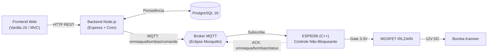

# 🌊 OmniAqua — Dosador Automatizado para Aquários (IoT)

[](LICENSE)
[](#hardware-e-embarcados)
[](#arquitetura-do-sistema)
[](#banco-de-dados)
[](#frontend)

**OmniAqua** é uma plataforma IoT completa e de código aberto para automação de dosagem periódica de suplementos líquidos (Cálcio, Reserva Alcalina/KH, Magnésio e Fertilizantes) em aquários marinhos e plantados de água doce.

---

## 📌 Arquitetura do Sistema

O projeto adota o padrão **Publish/Subscribe (Pub/Sub) assíncrono via MQTT**, desacoplando a interface web e a inteligência de negócios do atuador físico.



Para uma análise aprofundada de requisitos, contratos de mensageria JSON e To-Do lists de cada time, consulte o **[Documento de Transição Técnica (HANDOFF_OmniAqua.md)](./HANDOFF_OmniAqua.md)**.

---

## 📂 Estrutura do Repositório

```text
omniaquapp/
├── backend/
│   ├── database/
│   │   └── schema.sql                # Script DDL do banco e seeds iniciais
│   ├── scripts/
│   │   └── simulate_esp8266.js       # Simulador MQTT da placa para testes sem hardware
│   ├── src/                          # API REST, agendador cron e cliente MQTT
│   ├── .env.example                  # Variáveis de ambiente
│   └── package.json                  # Dependências do backend
├── firmware/
│   ├── omniaqua_esp8266/
│   │   ├── omniaqua_esp8266.ino      # Firmware C++ completo (MQTT, ArduinoJson, millis)
│   │   └── config.example.h          # Modelo de credenciais Wi-Fi e MQTT
│   └── platformio.ini                # Configuração para desenvolvedores PlatformIO
├── mosquitto/
│   └── config/
│       └── mosquitto.conf            # Configuração do broker local Mosquitto
├── css/
│   └── styles.css                    # Folha de estilos e animações aquáticas
├── js/
│   ├── controllers/
│   │   └── AppController.js          # Orquestrador de eventos e concorrência MVC
│   ├── services/
│   │   └── PumpService.js            # Camada de comunicação com a API REST / Mock
│   ├── views/
│   │   ├── FeedbackView.js           # Feedback visual e toasts acessíveis
│   │   ├── OceanView.js              # Animação marinha interativa em Canvas
│   │   └── PumpView.js               # Renderização dinâmica dos cartões das bombas
│   └── main.js                       # Ponto de entrada do Frontend
├── docker-compose.yml                # Sobe PostgreSQL e Mosquitto com 1 comando
├── index.html                        # Dashboard responsivo com Tailwind CSS
├── HANDOFF_OmniAqua.md               # Documentação técnica e To-Do lists detalhadas
├── LICENSE                           # Licença MIT
└── README.md                         # Documentação principal
```

---

## 🚀 Como Executar Localmente

### 1. Pré-requisitos
- [Git](https://git-scm.com/)
- [Docker](https://www.docker.com/) e Docker Compose
- [Node.js](https://nodejs.org/) (versão 18+)
- [Arduino IDE](https://www.arduino.cc/) ou [PlatformIO](https://platformio.org/) (para quem for programar na placa)

---

### 2. Subir a Infraestrutura Local (Banco + Broker MQTT)
Na raiz do repositório, execute:

```bash
docker compose up -d
```

Isso inicializa automaticamente:
- **Broker MQTT (Eclipse Mosquitto):** Porta `1883`
- **Banco PostgreSQL 16:** Porta `5432` com as tabelas e dados iniciais já populados via [`backend/database/schema.sql`](./backend/database/schema.sql)

---

### 3. Rodar o Frontend (Dashboard)
Como o projeto utiliza **JavaScript Modular nativo (ES Modules com `type="module"`)**, os navegadores modernos bloqueiam a abertura direta por dois cliques no arquivo (`file:///`) por regras de segurança (CORS). É necessário rodar através de um servidor HTTP local:

#### Opção A: VS Code (Recomendada / Mais Fácil - Sem Terminal)
1. Instale a extensão oficial **[Live Server](https://marketplace.visualstudio.com/items?itemName=ritwickdey.LiveServer)** no seu VS Code.
2. Clique com o botão direito sobre o arquivo [`index.html`](./index.html) e selecione **"Open with Live Server"**.
3. O painel abrirá automaticamente em `http://localhost:5500` com recarregamento em tempo real (hot-reload).

#### Opção B: Via Node.js (`npx serve`)
```bash
# Executa na porta 8000 (para não conflitar com a API na porta 3000)
npx serve -l 8000 .
```
Acesse em: [http://localhost:8000](http://localhost:8000)

#### Opção C: Via Python
```bash
# No Windows:
python -m http.server 8000

# No macOS ou Linux:
python3 -m http.server 8000
```
Acesse em: [http://localhost:8000](http://localhost:8000)

---

### 4. Rodar o Backend (API REST + Scheduler MQTT)
```bash
cd backend
npm install
cp .env.example .env
npm run dev
```
A API iniciará na porta `3000` conectando ao banco PostgreSQL e ao Mosquitto.

---

### 5. Testar sem a Placa Física (Simulador ESP8266)
Se você estiver desenvolvendo a API ou a interface e não tiver a placa ESP8266 em mãos, execute o simulador em um terminal separado:

```bash
cd backend
npm run simulate
```
O simulador conecta ao Mosquitto, recebe os comandos de dosagem via MQTT, emula o tempo da bomba ligada e responde com a confirmação (ACK) automaticamente!

---

### 6. Gravar o Firmware no ESP8266 Físico

1. Acesse o diretório `firmware/omniaqua_esp8266/`.
2. Duplique o arquivo `config.example.h` e renomeie a cópia para `config.h`:
   ```bash
   cp config.example.h config.h
   ```
3. Abra o `config.h` e insira o SSID/senha do seu Wi-Fi e o IP da sua máquina com o Broker MQTT (o arquivo `config.h` já está protegido pelo `.gitignore`).
4. Abra `omniaqua_esp8266.ino` na Arduino IDE ou abra a pasta `firmware/` no PlatformIO.
5. Bibliotecas necessárias: `PubSubClient` e `ArduinoJson` (já configuradas no `platformio.ini`).
6. Conecte a placa via USB e faça o upload para a porta COM correspondente.

---

## 🛡️ Proteções Elétricas e de Software
- **Isolação e Nível Lógico:** O transistor MOSFET canal N **IRLZ44N** é acionado pelo pino `D1` (GPIO 5) a 3.3V com resistor limitador (220Ω) e resistor pull-down (10kΩ ao GND) para impedir disparos acidentais no boot.
- **Proteção Contra EMF Reversa:** Diodo flyback **1N4007** em paralelo reverso com os terminais do motor da bomba peristáltica.
- **Fail-Safe de Firmware:** Trava máxima de tempo no microcontrolador (`TEMPO_MAX_SEGURANCA_MS = 30000`). Se um comando solicitar dosagem maior que 30 segundos, a placa rejeita e reporta erro imediatamente, impedindo acidentes com os animais aquáticos.

---

## 📄 Licença
Distribuído sob a licença [MIT](LICENSE).
