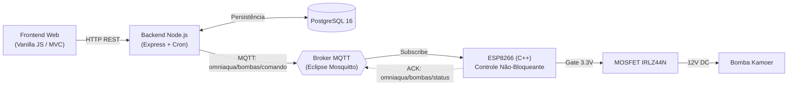

# 🌊 OmniAqua — Dosador Automatizado para Aquários (IoT)

[](LICENSE)
[](#hardware-e-embarcados)
[](#arquitetura-do-sistema)
[](#banco-de-dados)
[](#frontend)

**OmniAqua** é uma plataforma IoT completa e de código aberto para automação de dosagem periódica de suplementos líquidos (Cálcio, Reserva Alcalina/KH, Magnésio e Fertilizantes) em aquários marinhos e plantados de água doce.

---

## 📌 Arquitetura do Sistema

O projeto adota o padrão **Publish/Subscribe (Pub/Sub) assíncrono via MQTT**, desacoplando a interface web e a inteligência de negócios do atuador físico.



Para uma análise aprofundada de requisitos, contratos de mensageria JSON e To-Do lists de cada time, consulte o **[Documento de Transição Técnica (HANDOFF_OmniAqua.md)](./HANDOFF_OmniAqua.md)**.

---

## 📂 Estrutura do Repositório

```text
omniaquapp/
├── backend/
│   └── database/
│       └── schema.sql                # Script DDL do banco e seeds iniciais
├── firmware/
│   └── omniaqua_esp8266/
│       ├── omniaqua_esp8266.ino      # Firmware C++ completo (MQTT, ArduinoJson, millis)
│       └── config.example.h          # Modelo de credenciais Wi-Fi e MQTT
├── mosquitto/
│   └── config/
│       └── mosquitto.conf            # Configuração do broker local Mosquitto
├── css/
│   └── styles.css                    # Folha de estilos e animações aquáticas
├── js/
│   ├── controllers/
│   │   └── AppController.js          # Orquestrador de eventos e concorrência MVC
│   ├── services/
│   │   └── PumpService.js            # Camada de comunicação com a API REST
│   ├── views/
│   │   ├── FeedbackView.js           # Feedback visual e toasts acessíveis
│   │   ├── OceanView.js              # Animação marinha interativa em Canvas
│   │   └── PumpView.js               # Renderização dinâmica dos cartões das bombas
│   └── main.js                       # Ponto de entrada do Frontend
├── docker-compose.yml                # Sobe PostgreSQL e Mosquitto com 1 comando
├── index.html                        # Dashboard responsivo com Tailwind CSS
├── HANDOFF_OmniAqua.md               # Documentação técnica e To-Do lists detalhadas
├── LICENSE                           # Licença MIT
└── README.md                         # Documentação principal
```

---

## 🚀 Como Executar Localmente

### 1. Pré-requisitos
- [Git](https://git-scm.com/)
- [Docker](https://www.docker.com/) e Docker Compose
- [Node.js](https://nodejs.org/) (versão 18+)
- [Arduino IDE](https://www.arduino.cc/) ou [PlatformIO](https://platformio.org/) (para o firmware)

---

### 2. Subir a Infraestrutura Local (Banco + Broker MQTT)
Na raiz do repositório, execute:

```bash
docker compose up -d
```

Isso inicializa automaticamente:
- **Broker MQTT (Eclipse Mosquitto):** Porta `1883`
- **Banco PostgreSQL 16:** Porta `5432` com as tabelas e dados iniciais já populados via [`backend/database/schema.sql`](./backend/database/schema.sql)

---

### 3. Rodar o Frontend (Dashboard)
Você pode servir a pasta estática com qualquer servidor HTTP local:

```bash
# Opção 1: Via Python
python -m http.server 8000

# Opção 2: Via Node.js npx
npx serve .
```

Abra seu navegador em [http://localhost:8000](http://localhost:8000).

---

### 4. Gravar o Firmware no ESP8266

1. Acesse o diretório `firmware/omniaqua_esp8266/`.
2. Duplique o arquivo `config.example.h` e renomeie a cópia para `config.h`:
   ```bash
   cp config.example.h config.h
   ```
3. Abra o `config.h` e insira o SSID/senha do seu Wi-Fi e o IP do Broker MQTT (o arquivo `config.h` já está protegido pelo `.gitignore`).
4. Abra `omniaqua_esp8266.ino` na Arduino IDE ou PlatformIO.
5. Instale as bibliotecas necessárias:
   - `PubSubClient` (por Nick O'Leary)
   - `ArduinoJson` (v6 ou v7)
6. Conecte a placa via USB e faça o upload para a porta COM correspondente.

---

## 🛡️ Proteções Elétricas e de Software
- **Isolação e Nível Lógico:** O transistor MOSFET canal N **IRLZ44N** é acionado pelo pino `D1` (GPIO 5) a 3.3V com resistor limitador (220Ω) e resistor pull-down (10kΩ ao GND) para impedir disparos acidentais no boot.
- **Proteção Contra EMF Reversa:** Diodo flyback **1N4007** em paralelo reverso com os terminais do motor da bomba peristáltica.
- **Fail-Safe de Firmware:** Trava máxima de tempo no microcontrolador (`TEMPO_MAX_SEGURANCA_MS = 30000`). Se um comando solicitar dosagem maior que 30 segundos, a placa rejeita e reporta erro imediatamente, impedindo acidentes com os animais aquáticos.

---

## 📄 Licença
Distribuído sob a licença [MIT](LICENSE). Consulte `LICENSE` para obter mais detalhes.

